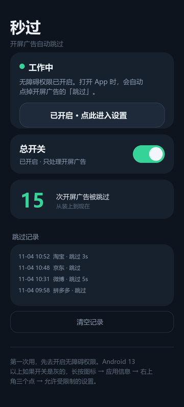

# 秒过 · MiaoGuo

一个自己写、自己编译、自己签名的安卓小工具：打开 App 时，替你点掉开屏广告上的「跳过」。

- **142 KB 源码，69.6 KB 安装包**，单 dex
- **零网络权限**（连 `INTERNET` 都没申请）
- 无第三方依赖，纯 Java + 原生 View
- 只在 App 刚切到前台的一小段时间内动作，认不出就不动



---

## 它可以跳过什么广告

带有跳过键的开屏广告——App 启动时占满屏幕、角落上有「跳过」「跳过 3」「关闭」的那一类。

按钮得能在无障碍树里读到：有文字，或者有像样的资源 id / 类名。读不到就不点。

## 实测范围

| App | 情况 |
|---|---|
| 淘宝、京东、B站、百度网盘、中国电信、12306、腾讯视频、爱奇艺 | 能跳 |
| 菜鸟 | 时好时坏，看广告模板 |

随着版本更新会有更多适配软件。

---

## 为什么这么设计

三条原则，按优先级排：

1. **不联网**。没有 `INTERNET` 权限，装什么都不会上传数据。可以自己验证：
   ```
   aapt2 dump permissions miaoguo-1.7.1.apk
   ```
   只会输出一条 `REQUEST_IGNORE_BATTERY_OPTIMIZATIONS`。

2. **不会误点**。误点一下可能点进广告、点进微信，甚至点到「立即领取」，比多看五秒广告难受得多。所以：
   - 大面积容器（超过屏幕 20%）一律不碰
   - 用户一滚动屏幕就立刻收手
   - 认不出就不动，绝不按坐标盲点

3. **只做一件事**。不拦网络、不搞规则订阅、不做悬浮窗，装完就一个小图标。

> 代价就是覆盖率不如那些带在线规则库、带屏幕录制的工具。这是一个明确的取舍。

---

## 安装

1. 到 [Releases](../../releases) 下载 `miaoguo-x.y.z.apk`
2. 传到手机上安装（未知来源需要允许）
3. 打开「秒过」，**第一次会先弹出「先说清楚」**——四件事看完再进使用引导

### 无障碍开关点不动？

Android 13 及以上对侧载应用有这个限制：

> 桌面 → 长按「秒过」→ 应用信息 → 右上角 ⋮ → **允许受限制的设置** → 再回来开无障碍

### 再加一步，别让它被系统杀掉

主页会检测省电白名单，没加就显示「加入省电白名单（推荐）」。也可以手动去手机管家 / 电池设置里允许后台运行。

---

## ⚠️ 关于支付 App 的提示

**开着无障碍服务时，支付宝、微信支付、部分银行 App 可能提示「支付环境异常」。**

这是安卓的通用检测，不是这个 App 特有的问题——任何第三方无障碍服务都会触发。

而且注意：**关掉「秒过」里的总开关没用**，因为服务本身还开着。要让提示消失，只能去系统设置里停用这个无障碍服务：

> 设置 → 无障碍 → 已下载的服务 → 秒过 → 关闭

付款前关一下，付完再开，是目前唯一可靠的办法。

---

## 自己编译

不需要 Gradle，也不需要 Android Studio。三步：

### 1. 下工具链（约 300 MB）

放到 `dl/` 目录：

| 文件 | 地址 |
|---|---|
| `jdk17.zip` | https://mirrors.huaweicloud.com/openjdk/17.0.2/openjdk-17.0.2_windows-x64_bin.zip |
| `build-tools-34.zip` | https://mirrors.cloud.tencent.com/AndroidSDK/build-tools_r34-windows.zip |
| `platform-34.zip` | https://mirrors.cloud.tencent.com/AndroidSDK/platform-34-ext12_r01.zip |

> `dl.google.com` 在国内不可达，上面用的是腾讯云镜像。

### 2. 解包

```powershell
python extract.py
```

### 3. 编译

```powershell
powershell -NoProfile -ExecutionPolicy Bypass -File .\build.ps1
```

产物在 `out/miaoguo-<版本>.apk`。

### 三个已经踩过的坑

1. **`build.ps1` 必须保持纯 ASCII**。Windows PowerShell 5.1 会把没有 BOM 的 .ps1 按 ANSI 读，中文会直接让脚本解析失败。
2. **aapt2 打不开中文路径**。脚本会自动在临时目录搭一个纯 ASCII 的构建区，用 junction 指向工具链（不复制），编完把 APK 拷回来。所以工程放在任何路径下都能编。
3. **版本号只写在 `app/AndroidManifest.xml`**。构建脚本从那里读 `versionCode` / `versionName`，不会出现两处不一致。

如果机器上已有 JDK 17+，可以跳过 `jdk17.zip`：

```powershell
$env:MIAOGUO_JDK = "C:\Program Files\Java\jdk-17"
```

> `build.ps1` 在找不到密钥时会自己生成一个自签证书。**自己生成的证书签出来的包不能覆盖安装官方 releases**，想升级要先卸载。

---

## 工作原理

```
App 切到前台
 └─ 45 秒窗口开始
      ├─ 每 400ms 主动扫一次（前 15 秒密，之后 900ms），不依赖系统事件
      ├─ 候选按可信度排：资源 id / 类名  >  裸「跳过」  >  其它文字
      ├─ 硬条件：本 App、可见、可用、面积 ≤ 屏幕 20%、不在可滚动容器里
      └─ 命中 → 点击（第一次无障碍点击；重试用 100ms 真实触摸）
           └─ 250ms 后复查，按钮真没了才记一笔 ✓，最多试 8 次
```

- 点完必须复查，**「点击被受理」不算成功**，「按钮消失」才算
- 检测到你滚动屏幕 → 立刻停止，不再碰屏幕
- 熄屏 / 锁屏 → 不动作
- 自己的界面、系统界面 → 绝不动作

---

## 目录

```
app/
├── AndroidManifest.xml
├── src/com/miaoguo/skip/
│   ├── MainActivity.java       设置页、状态、记录
│   ├── DisclaimerActivity.java 首次打开的免责声明
│   ├── GuideActivity.java      三步使用引导
│   ├── SkipService.java        核心：无障碍服务
│   ├── ToggleSwitch.java       自绘开关
│   └── Prefs.java              配置 / 记录 / 心跳
└── res/                        布局、文案、图标

build.ps1     aapt2 → javac → d8 → 打包 → 对齐 → 签名
extract.py    解包工具链
pack_dex.py   把 classes.dex 塞进 APK
preview/      界面预览图（按代码尺寸渲染，不是真机截图）
```

---

## 版本

| 版本 | 主要变化 |
|---|---|
| 1.7.1 | 免责声明扩写为 8 条完整条款 |
| 1.7.0 | 新增「先说清楚」页，首次打开先看 |
| 1.6.0 | 复查间隔 400ms → 250ms |
| 1.5.10 | 状态检测改用系统接口（修「明明开了却显示未开启」） |
| 1.5.9 | 候选按 id 优先排序，菜鸟重新放回 |
| 1.5.6 | 连点 8 次，拿下腾讯视频 |
| 1.5.1 | 移除「按位置猜」和 `jump` 关键词——两次误点之后的回退 |
| 1.5.0 | 45 秒窗口；裸「跳过」放行可滚动容器；认「关闭X」 |
| 1.4.4 | 记录区改成内嵌滚动 |
| 1.4.2 | 修「跳过了却没记录」 |
| 1.4.1 | 三级识别 + 主动轮询 |
| 1.4.0 | 点击后复查、拒绝大容器、倒计时归一 |
| 1.0–1.3 | 第一版到 20 秒窗口，内部迭代 |

---

## 许可证

[GPL-3.0](LICENSE)。

用它可以，改它可以，但改完也要开源。软件按「原样」提供，不附带任何担保。
